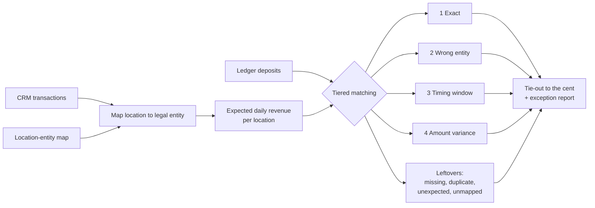

# Multi-Entity Revenue Reconciliation

A reconciliation engine that ties CRM revenue to accounting deposits across many legal entities, classifies every difference, and explains the gap **to the cent**.

It is a clean-room rebuild of an approach I use in production at a multi-location healthcare organization. Everything in this repository runs on **synthetic data**; no real company, patient or financial data is included.

## The problem

Multi-location businesses often run one CRM or point-of-sale system but keep separate books for each legal entity. Revenue is recorded in the CRM, then posted to accounting as daily deposits. Across dozens of locations and a dozen entities, small posting errors add up:

- deposits that post a few days late
- deposits that never post, or post twice
- deposits booked with the wrong amount
- deposits booked to the wrong legal entity
- new locations that nobody mapped to an entity yet

Finding these by hand in spreadsheets takes days each month, and "close enough" totals hide real errors.

## What the engine does



1. **Map** every CRM location to its legal entity. Locations missing from the map are isolated instead of silently dropped.
2. **Aggregate** CRM sales into the expected daily deposit per location.
3. **Match in tiers**, strictest first, so each deposit is claimed by the most confident rule that fits it: exact match, then wrong entity, then late posting within a timing window, then amount variance.
4. **Classify leftovers** as missing, duplicated, unexpected or unmapped.
5. **Tie out**: prove that the total CRM-to-ledger difference equals the sum of classified exceptions, with zero unexplained cents. All money is handled as integer cents to avoid floating-point drift.

## Results on synthetic data

The generator builds 90 days of activity for 58 locations across 11 entities, then deliberately corrupts a share of deposits and records each corruption in an answer key.

| Measure | Result |
| --- | --- |
| CRM transactions | 31,464 |
| Revenue reconciled | $5,575,855.13 |
| Injected issues | 184 across 5 types, plus 1 unmapped location |
| Issues found and correctly classified | 184 of 184 |
| False positives | 0 |
| Unexplained difference | $0.00 |

The test suite checks the engine against the answer key on every run. See the full [sample report](docs/sample_summary.md).

## Quick start

```bash
git clone https://github.com/quanti-nomad>/multi-entity-revenue-reconciliation.git
cd multi-entity-revenue-reconciliation
pip install -r requirements.txt

PYTHONPATH=src python -m recon demo     # generate data, reconcile, write report
pytest -q                               # verify against the answer key
```

Outputs land in `output/`: `summary.md`, `exceptions.csv`, `entity_summary.csv` and `all_lines.csv`.

To use your own files, put `crm_transactions.csv`, `ledger_deposits.csv` and `location_entity_map.csv` in a folder with the same columns as the generated data and run:

```bash
PYTHONPATH=src python -m recon run --data path/to/folder --out output --window 3
```

## Project structure

```
src/recon/
  generate.py    synthetic data + answer key
  reconcile.py   tiered matching engine and tie-out
  report.py      CSV outputs and markdown summary
  cli.py         command line entry point
tests/           accuracy tests against the answer key
docs/            case study and sample report
```

## Design decisions

- **Integer cents, not floats.** A tie-out that is off by $0.01 is not a tie-out.
- **Tiered matching over fuzzy scoring.** Each exception type maps to a specific accounting action (reclass, reverse, post, investigate), so the rules stay explainable to a finance team.
- **An answer key for synthetic data.** Accuracy is measured, not assumed.
- **Unmapped locations get their own bucket.** They are the most common cause of silent revenue gaps after an acquisition or new opening.

## Taking it to production

In a live environment the same engine sits behind:

- a direct accounting API integration (for example, QuickBooks Online) across every entity
- a scheduled pull from the CRM database
- a daily run that writes exceptions to the BI layer (Domo, Power BI or a warehouse table)
- an AI assistant that drafts the explanation and suggested journal entry for each exception, with a person approving every posting

See the [case study](docs/case-study.md) for the business context.

## About

Built by **Miguel Tomada**, Data, Analytics & AI leader. I build data platforms, reporting governance and AI automation for multi-location healthcare and franchise organizations.
